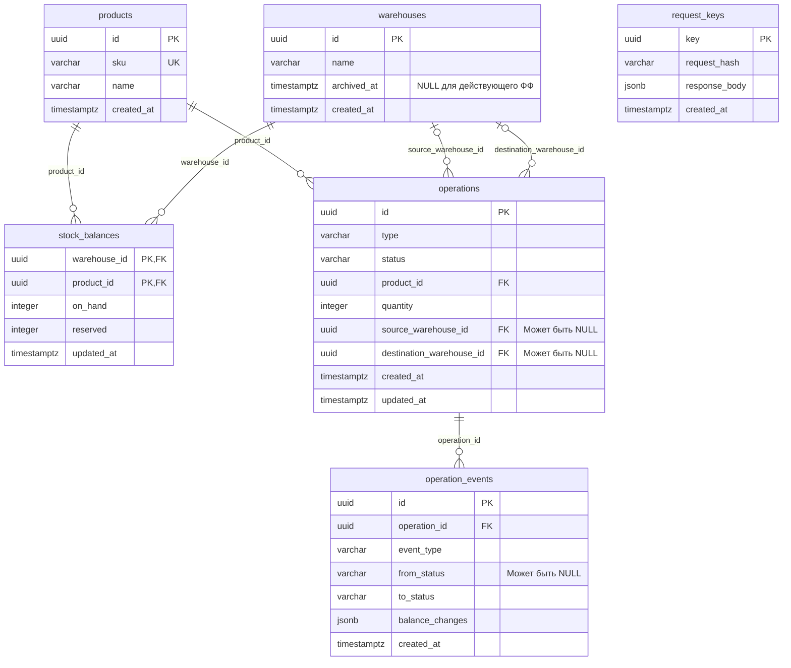

# CheckStock

Веб-прототип складского учёта для одного магазина: товары на нескольких ФФ, резервы FBS, перемещения между ФФ и поставки FBO.

Стек: Python 3.12, FastAPI, SQLAlchemy 2 ORM, PostgreSQL, асинхронный драйвер psycopg 3. Интерфейс — HTML/CSS/JavaScript, без отдельной сборки. Страницы и API обслуживает одно приложение.

## Запуск через Docker Compose

Установите Git и Docker Desktop. Перед выполнением команд запустите Docker Desktop.

Склонируйте репозиторий и перейдите в папку проекта:

```sh
git clone https://github.com/2blackdragon/CheckStock.git
cd CheckStock
```

Выполните команды запуска из папки `CheckStock`, в которой находится `compose.yaml`:

```sh
docker compose up --build -d
docker compose exec app python -m app.seed
```

Откройте [CheckStock](http://localhost:8000). Описание API: [Swagger](http://localhost:8000/docs).

Тестовые приходы: SKU-101 «Органайзер» — Север 10, Юг 6; SKU-102 «Контейнер» — Север 5, Юг 0; SKU-103 «Корзина» — Север 0, Юг 4. Заполнение выполняется отдельной командой; повторный запуск не увеличивает остатки и не восстанавливает изменённые пользователем количества.

```sh
docker compose logs app
docker compose down
```

Остановка сохраняет базу в Docker volume. Не используйте `down -v`, если хотите сохранить данные.

## Интерфейс

- Остатки: поиск по SKU/названию, фильтр ФФ, резерв/товар в пути; нажмите на товар для разбивки по складам и просмотра 25 последних операций. Без фильтра учитываются все ФФ, включая архивные. При выборе ФФ перемещения разделяются на входящие и исходящие.
- Операции: по умолчанию только незавершённые резервы и поставки, кнопки отправки, отмены и приёмки; переключение на все операции показывает и отправленные FBS.
- Склады: создание, переименование, архивирование и восстановление, переход к остаткам ФФ.
- История: время складского действия, SKU, количество, маршрут и статус после действия. По умолчанию дата начала — 30 дней назад; очистка даты снимает ограничение по периоду. Создание, переименование, архивирование и восстановление самих ФФ в историю складских операций не записываются.

## Правила учёта

Доступно = физически на ФФ − резерв FBS. Резерв входит в физический остаток. При отправке товар уходит с ФФ и учитывается в пути; на склад назначения поступает только после приёмки. Суммарная таблица не прибавляет резервы к физическому остатку и не считает перемещение дважды.

Одна операция содержит один товар. Количества целые положительные, до 1 000 000 единиц на операцию. Отправка и приёмка целиком; частичных приёмок и редактирования проведённых операций нет.

- Приход: немедленно увеличивает остаток ФФ, статус «Проведено».
- Перемещение: создание сразу означает отправку; товар в пути до приёмки на другом ФФ. Отмена уже отправленного перемещения не предусмотрена.
- FBS: создание резерва → отправка либо отмена. Отправка одновременно уменьшает физический остаток и освобождает резерв. После отправки показывается «В пути к клиенту»; доставка и возвраты вне границ прототипа.
- FBO: создание сразу означает отправку → приёмка маркетплейсом. После приёмки партия видна в режиме «Все операции» и истории. Это подтверждение поставки, не актуальный остаток маркетплейса: дальнейших продаж в системе нет. Отмена отправленной поставки не предусмотрена.
- Нехватка проверяется только на выбранном ФФ по доступному количеству. В ошибке перечисляются до 10 других ФФ с положительным доступным остатком, включая архивные; автоматического списания с них нет.

### Архивирование ФФ

Архивирование разрешено с товаром и незавершёнными операциями. ФФ сохраняется в базе, его остатки учитываются. Архивный статус обозначается в списке складов, полях выбора и карточке товара. В истории сохраняется название ФФ без отдельной пометки архива. Новые приходы, резервы FBS, отправки FBO и перемещения на архивный склад запрещены. Можно переместить свободный товар с архивного ФФ на действующий, отправить/отменить существующий FBS-резерв и принять уже отправленное перемещение. Восстановление возвращает обычные действия.

### Транзакции, повторные запросы и параллельная работа

Каждый изменяющий запрос выполняется в отдельной сессии и транзакции. Для складских операций остатки, статус, история и результат запроса сохраняются вместе; при ошибке изменения откатываются.

Повторный запрос с тем же UUID-ключом возвращает сохранённый результат. Если содержимое изменилось, сервер отвечает 409. Дополнительная проверка статуса операции исключает повторное списание или зачисление даже с новым ключом.

Точечные блокировки PostgreSQL защищают:

- Конкретный остаток «товар + ФФ» — от конкурирующих изменений.
- Конкретную операцию — от повторного подтверждения и одновременной отправки/отмены.
- ФФ — от конфликта архивирования с выполняющимися складскими действиями.
- Ключ запроса — от одновременного выполнения его дублей.

Независимые остатки обрабатываются параллельно. Блокировки берутся в согласованном порядке и освобождаются при завершении транзакции. Обычный просмотр данных не требует явных блокировок.

Ограничения базы запрещают отрицательные остатки, резерв сверх наличия и некорректные состояния операций. История складских действий сохраняется; переименование ФФ обновляет отображаемое название без потери связей.

### Производительность

Остатки, операции и история читаются постранично: интерфейс запрашивает по 25 строк, API допускает до 100. Поиск и фильтрация выполняются на сервере. Сортировка фиксирована: остатки по SKU, операции и история от новых к старым; выбора сортировки в интерфейсе нет. В остатках балансы и партии в пути агрегируются отдельно: соединение нескольких партий не умножает физический остаток. Индексы определены в ORM-моделях. Поиск с задержкой 300 мс; предыдущий запрос таблицы отменяется. После успешного действия текущая таблица обновляется. При возвращении на вкладку таблица обновляется, если нет открытого диалога. Остатки не кэшируются.

Каталог для форм загружает до 1000 товаров и до 1000 ФФ. Раздел «Склады» показывает этот список без постраничной навигации. В карточке товара — до 1000 ФФ и 25 последних операций. Это явные границы прототипа. Для большего каталога нужен серверный поиск в полях выбора и пагинация списка ФФ. Полнотекстовый/триграммный индекс нужен при росте каталога; виртуализация строк пока не требуется.

## Схема базы данных

Схема соответствует моделям в `app/models.py`. `PK` — первичный ключ, `FK` — внешний ключ, `UK` — уникальное значение. Временные поля имеют тип `timestamptz`.



| Таблица | Назначение |
|---|---|
| `products` | Товары с уникальным артикулом SKU. |
| `warehouses` | ФФ; заполненное `archived_at` обозначает архивный склад. |
| `stock_balances` | Физический остаток и резерв товара на конкретном ФФ. |
| `operations` | Приходы, перемещения, заказы FBS и поставки FBO с текущим статусом. |
| `operation_events` | История переходов операции и изменений остатков по ФФ в `balance_changes`. |
| `request_keys` | Ключи успешно выполненных запросов, хеш содержимого и сохранённый ответ для безопасного повторения. |

Для `stock_balances` используется составной первичный ключ `(warehouse_id, product_id)`. Доступное количество вычисляется как `on_hand - reserved`, а товар в пути — по типу и статусу операций; отдельные счётчики для них не хранятся.

У операции один товар. Склад отправления или назначения может отсутствовать в зависимости от типа: у прихода указан только получатель, у перемещения — оба ФФ, у FBS/FBO — только отправитель. Клиент и маркетплейс подразумеваются типом операции и не являются отдельными записями `warehouses`.

`request_keys` не имеет внешних ключей: результат действия хранится в JSONB и может относиться к складской операции или изменению ФФ. Все внешние ключи остальных таблиц используют `ON DELETE RESTRICT`; архивирование ФФ сохраняет связанные записи. Ограничения `CHECK` защищают количества и допустимые сочетания типа, статуса и маршрута операции.

## Устройство проекта

- `app/models.py` — модели SQLAlchemy, ограничения и индексы.
- `app/db.py` — async engine, фабрика сессий и создание первой схемы.
- `app/service.py` — транзакционные команды складского учёта.
- `app/queries.py` — ORM-запросы для экранов, без SQL-строк в обработчиках.
- `app/main.py` — валидация и асинхронные HTTP-обработчики.
- `app/seed.py` — воспроизводимые тестовые приходы.
- `app/static/`, `app/templates/` — интерфейс.
- `tests/test_scenarios.py` — сценарии на реальной PostgreSQL.

## Тесты

В `tests/test_scenarios.py` — 21 интеграционная проверка (20 функций, одна с двумя наборами параметров). Тесты обращаются к API приложения и реальной PostgreSQL в отдельной тестовой базе; внешний вид интерфейса ими не проверяется.

Все команды выполняются из папки `CheckStock` при запущенном Docker Desktop.

Подготовьте базу и образ приложения:

```sh
docker compose up -d --wait db
docker compose build app
```

Один раз создайте тестовую базу. Если `checkstock_test` уже существует, пропустите этот шаг:

```sh
docker compose exec db createdb -U checkstock checkstock_test
```

Запустите проверки:

```sh
docker compose run --rm --no-deps \
  -e TEST_DATABASE_URL=postgresql://checkstock:checkstock@db:5432/checkstock_test \
  app python -m pytest -q
```

При успешном выполнении в конце будет `21 passed`. Тесты создают свои записи в `checkstock_test`; рабочая база `checkstock` не используется. Веб-приложение для запуска проверок не требуется. Переменная `TEST_DATABASE_URL` обязательна: без неё тесты пропускаются.

Покрыты:

- Приход, резерв FBS, отмена и отправка; перемещения между ФФ и приёмка FBO.
- Нехватка на выбранном ФФ с учётом резервов, некорректные количества и перемещение на тот же склад.
- Архивирование с остатками и незавершёнными операциями, вывод товара и восстановление ФФ.
- Повторные запросы, подтверждения и конфликтующие действия без двойного списания или зачисления.
- Параллельные резервы, первые приходы, приёмки и встречные перемещения; согласование архивации с приходом и независимость разных остатков.
- Поиск, пагинация, фильтры, переименование ФФ, согласованность итогов и восстановление остатков из истории.
